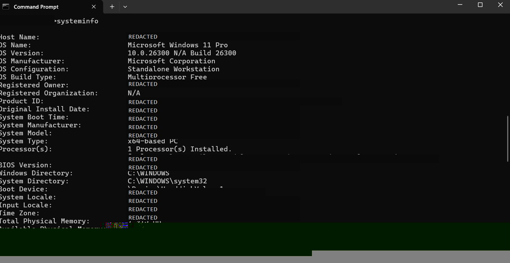

# CMD Commands

**Module:** 2 — CMD and PowerShell  
**Status:** Practised `hostname`, `whoami`, and `ipconfig`. Other listed CMD commands remain to be practised.

| Command | Purpose | Practice status |
|---|---|---|
| `ipconfig` | Displays network adapter configuration, including IP settings. | Practised. The visible output included two disconnected wireless virtual adapters and a VMware VMnet1 adapter. The screenshot cuts off before the full output; exact IP addresses are redacted. |
| `systeminfo` | Displays operating system and hardware information. | Practised. This output reports Windows 11 Pro, version `10.0.26300`, build `26300`, and about 8 GB of physical memory. Identifying details are redacted in the screenshot. |
| `whoami` | Displays the current account identity. | Practised. It returned a computer-and-account identity; both values are redacted. |
| `tasklist` | Lists running processes with process name, PID, session, and memory use. | Practised. The visible rows included Windows processes such as `System`, `Registry`, `services.exe`, and multiple `svchost.exe` entries. PIDs are redacted; process and memory values are a snapshot. |
| `net user` | Lists local user accounts. | To practise |
| `hostname` | Displays the computer name. | Practised. The computer name is redacted. |
| `netstat -ano` | Displays network connections/listeners and associated process IDs. | To practise |
| `dir` | Lists files and folders in the current directory. | To practise |

## Notes

`ipconfig` can list several adapters, including virtual adapters. An address shown under a VMware adapter belongs to that virtual network interface; it should not automatically be treated as the laptop's Wi-Fi address or public internet address. This screenshot shows only the beginning of the complete `ipconfig` output.

The `systeminfo` screenshot reports Windows 11 Pro, version `10.0.26300`, build `26300`. An earlier PowerShell `Get-ComputerInfo` screenshot reported Windows 10 Pro. These captured outputs differ, so verify the installed Windows edition in **Settings > System > About** before treating either report as definitive. The system information output also showed about 8 GB of physical memory; available memory is a changing snapshot.

## Evidence

The account name, computer name, and visible IP addresses have been redacted.

