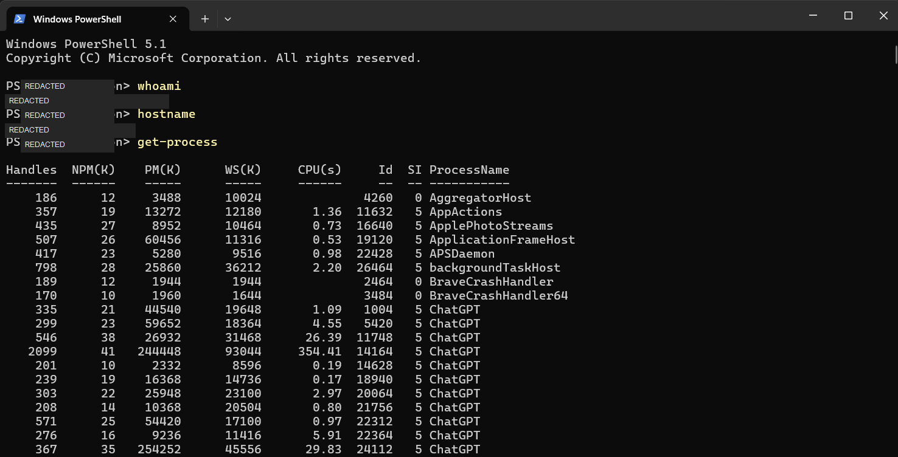
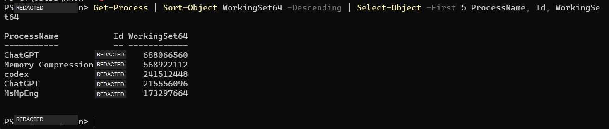
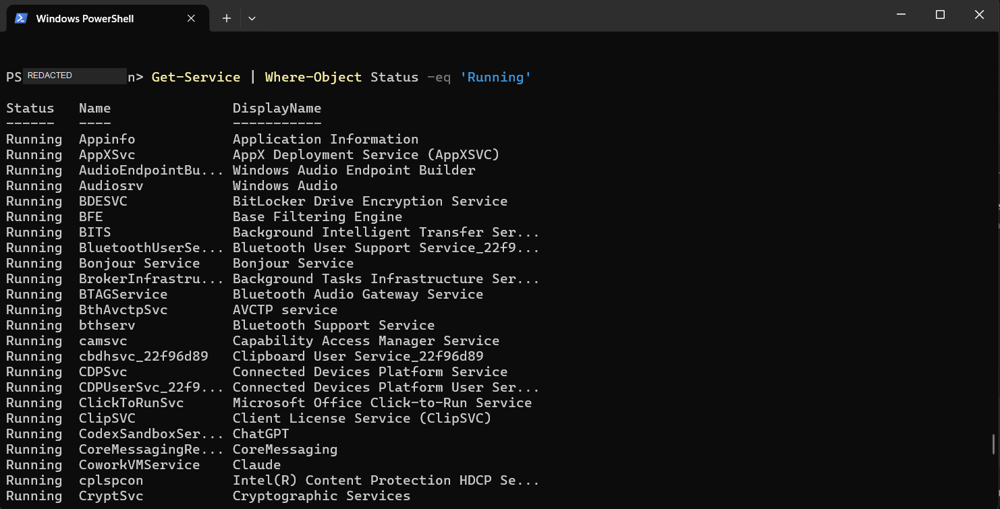
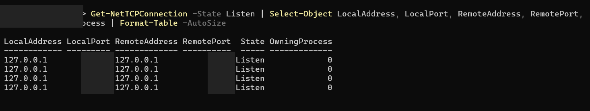
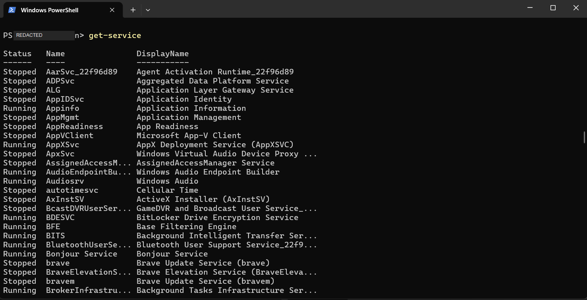
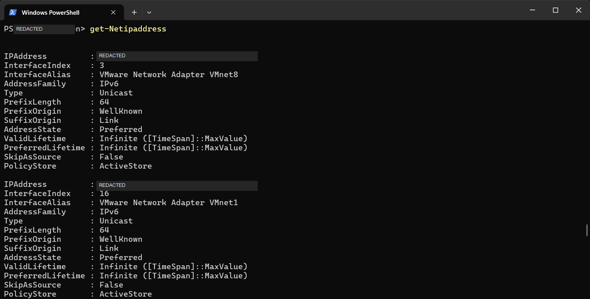
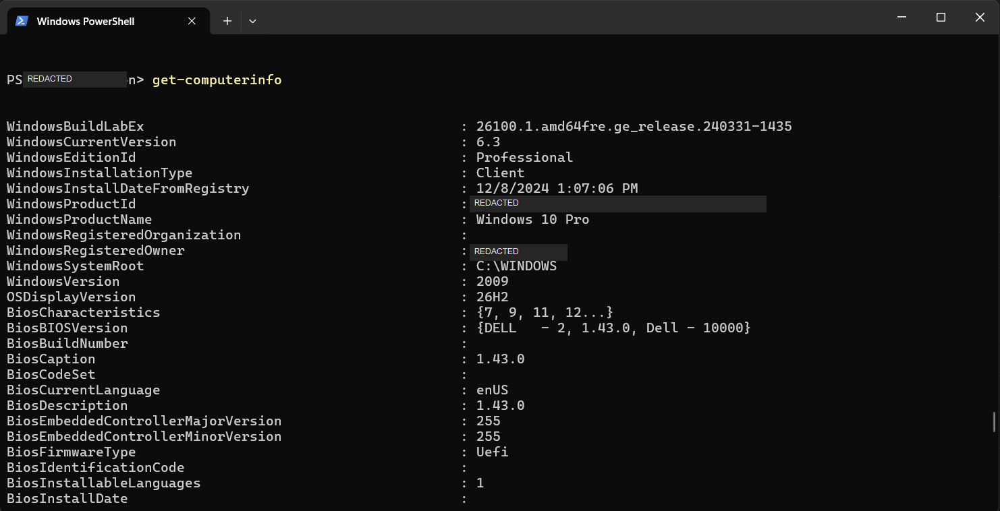

# PowerShell Commands

**Module:** 2 — CMD and PowerShell  
**Environment:** Windows PowerShell 5.1

## Commands practised

| Command | What it shows | Observation / status |
|---|---|---|
| `whoami` | The current account identity. | Observed a `COMPUTER\USER`-style result. The exact value is redacted in the shared evidence. |
| `hostname` | The computer's network name. | Returned the device name. The exact value is redacted in the shared evidence. |
| `Get-Process` | Running processes and fields such as process name, process ID, CPU time, and memory. | Similar to Task Manager. One application can appear on multiple rows because it can run several processes. |
| `Get-Service` | Windows services and their current states. | Used `Get-Service | Where-Object Status -eq 'Running'` to list running services only. The screenshot shows the beginning of the results; the list continues beyond the visible area. |
| `Get-NetIPAddress` | IP address details for network interfaces. | The output included Wi-Fi, loopback, virtual VMware adapters, Bluetooth, and other interfaces, with IPv4 and IPv6 records. Exact addresses are redacted. |
| `Get-ComputerInfo` | Computer, operating system, and firmware information. | The output contains many system details. The registered owner and Windows Product ID are redacted in the shared screenshot. |
| `Get-LocalUser` | Local user accounts. | Not yet practised. |
| `Get-NetTCPConnection` | TCP connections and their states. | Filtered for `Listen`; four loopback rows appeared. `OwningProcess` showed `0`, so this output did not identify an application. Port values are redacted in the shared screenshot. |
| `Get-WinEvent` | Windows event log records. | Not yet practised. |
| `Get-EventLog` | Entries from supported event logs. | Not yet practised. |

## Top five processes by memory

Command used:

```powershell
Get-Process | Sort-Object WorkingSet64 -Descending | Select-Object -First 5 ProcessName, Id, WorkingSet64
```

`WorkingSet64` is reported in bytes. The values below are converted to MiB (1 MiB = 1,048,576 bytes); process IDs are omitted from this note.

| Process name | Memory (approx. MiB) |
|---|---:|
| ChatGPT | 656.2 |
| Memory Compression | 542.6 |
| codex | 230.3 |
| ChatGPT | 205.6 |
| MsMpEng | 165.3 |

ChatGPT appears twice because the command lists individual processes; it does not combine all processes belonging to the same app. Memory usage changes over time, so this is a snapshot.

## Listening TCP connections

Command used:

```powershell
Get-NetTCPConnection -State Listen | Select-Object LocalAddress, LocalPort, RemoteAddress, RemotePort, State, OwningProcess | Format-Table -AutoSize
```

The output showed four rows in the `Listen` state using `127.0.0.1` for both addresses. `OwningProcess` was `0`, so this result did not identify an application. Port values are covered in the public screenshot.

## Evidence

The screenshots below show actual PowerShell output. Identifying values have been covered in the shared copies.

### Identity and process listing



### Top five processes by memory



### Running services



### Listening TCP connections



### Full service list



### Network interfaces



### Computer information



