# PowerShell Commands

**Module:** 2 — CMD and PowerShell  
**Environment:** Windows PowerShell 5.1

## Commands practised

| Command | What it shows | Observation / status |
|---|---|---|
| `whoami` | The current account identity. | Observed a `COMPUTER\USER`-style result. The exact value is redacted in the shared evidence. |
| `hostname` | The computer's network name. | Returned the device name. The exact value is redacted in the shared evidence. |
| `Get-Process` | Running processes and fields such as process name, process ID, CPU time, and memory. | Similar to Task Manager. One application can appear on multiple rows because it can run several processes. |
| `Get-Service` | Windows services and their current states. | Used `Get-Service | Where-Object Status -eq 'Running'` to list running services only. The screenshot shows the beginning of the results; the list continues beyond the visible area. |
| `Get-NetIPAddress` | IP address details for network interfaces. | The output included Wi-Fi, loopback, virtual VMware adapters, Bluetooth, and other interfaces, with IPv4 and IPv6 records. Exact addresses are redacted. |
| `Get-ComputerInfo` | Computer, operating system, and firmware information. | The output contains many system details. The registered owner and Windows Product ID are redacted in the shared screenshot. |
| `Get-LocalUser` | Local user accounts and whether each account is enabled. | Listed eight accounts. Personal and app-specific account names are redacted in the shared screenshot. |
| `Get-NetTCPConnection` | TCP connections and their states. | `-State Listen` returned four rows using `127.0.0.1` for the local and remote addresses. Port values are redacted in the shared screenshot. |
| `Get-WinEvent` | Windows event log records, including records from modern Windows event logs. | Practised in two forms: the default event view and a `Select-Object` pipeline that shows chosen fields. |
| `Get-EventLog` | Entries from classic Windows event logs. | Practised with `Get-EventLog -LogName System -Newest 10`. The output showed the newest 10 System log entries, including `Warning` and `Information` types. Several messages reported an unrecognized USB driver; this observation alone does not identify a cause. |

## Top five processes by memory

Command used:

```powershell
Get-Process | Sort-Object WorkingSet64 -Descending | Select-Object -First 5 ProcessName, Id, WorkingSet64
```

`WorkingSet64` is reported in bytes. The values below are converted to MiB (1 MiB = 1,048,576 bytes); process IDs are omitted from this note.

| Process name | Memory (approx. MiB) |
|---|---:|
| ChatGPT | 656.2 |
| Memory Compression | 542.6 |
| codex | 230.3 |
| ChatGPT | 205.6 |
| MsMpEng | 165.3 |

ChatGPT appears twice because the command lists individual processes; it does not combine all processes belonging to the same app. Memory usage changes over time, so this is a snapshot.

## Listening TCP connections

Command used:

```powershell
Get-NetTCPConnection -State Listen
```

The output showed four rows in the `Listen` state using `127.0.0.1` for both addresses. Port values are covered in the public screenshot.

## Local user accounts

Command used:

```powershell
Get-LocalUser
```

The output listed eight local accounts and showed whether each was enabled. Personal and app-specific account names are redacted in the shared screenshot.

## Windows event log with `Get-WinEvent`

`Get-WinEvent` was practised in two forms. Both retrieve the 10 newest records from the System log; the second command selects a concise set of fields.

### Full event view

```powershell
Get-WinEvent -LogName System -MaxEvents 10
```

This default view displays provider groupings and event details, including the message text. The captured output included a DistributedCOM warning, `hcmon` warnings describing an unrecognized USB driver, and Service Control Manager information events.

### Selected event fields

```powershell
Get-WinEvent -LogName System -MaxEvents 10 | Select-Object TimeCreated, Id, LevelDisplayName, ProviderName
```

The pipeline keeps the date/time, event ID, level, and provider name, making the results shorter and easier to scan. It omits the message text shown in the full view.

These entries are observations from one System log snapshot. The messages by themselves do not establish a cause or indicate whether action is required.

## System event log with `Get-EventLog`

`Get-EventLog` is a separate command used here to query a classic Windows event log. The two commands both show event records, but they use different command interfaces.

Command used:

```powershell
Get-EventLog -LogName System -Newest 10
```

The result showed each event's index, time, entry type, source, instance ID, and message. Several recent entries were warnings from `hcmon` whose messages described an unrecognized USB driver. Other entries included a DCOM warning and Service Control Manager information events. The output records event reports; this screenshot alone does not determine whether the warnings need action.

## Evidence

The screenshots below show actual PowerShell output. Identifying values have been covered in the shared copies.

### Identity and process listing

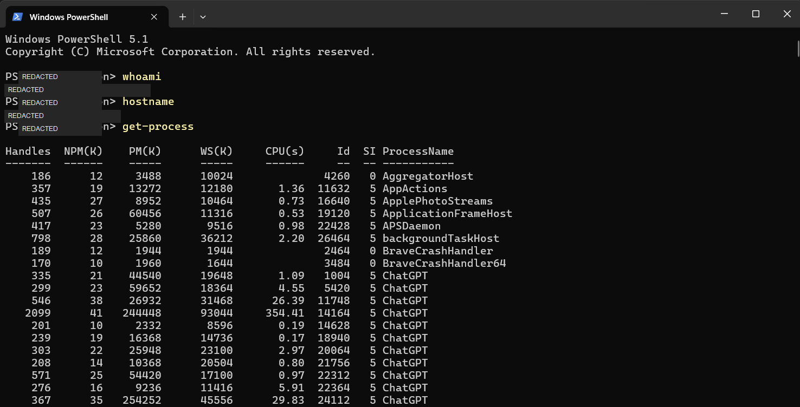

### Top five processes by memory

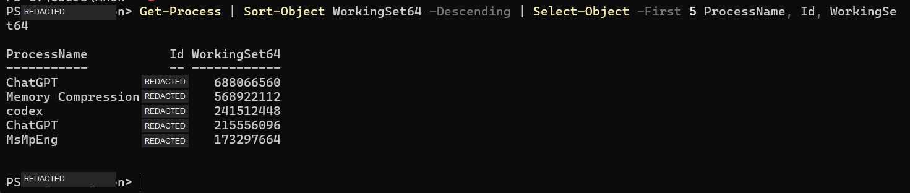

### Running services

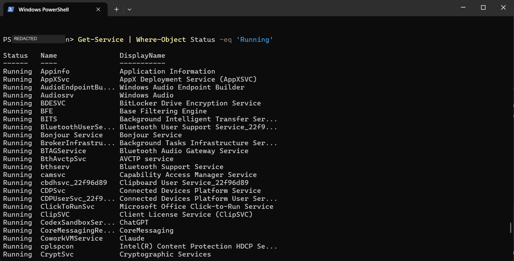

### Listening TCP connections

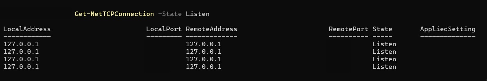

### Local user accounts

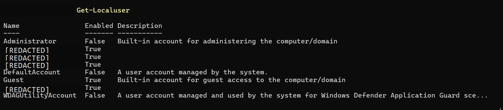

### `Get-WinEvent`: full event view

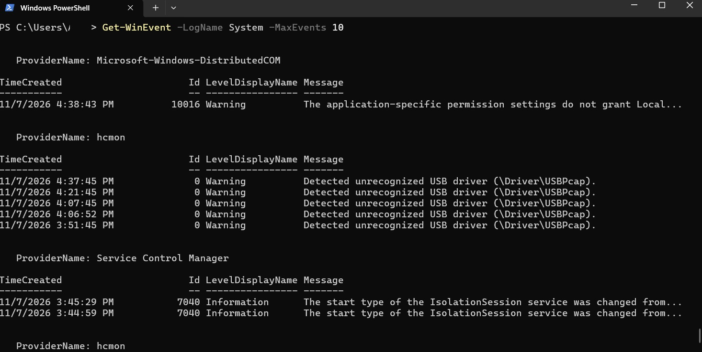

### `Get-WinEvent`: selected fields

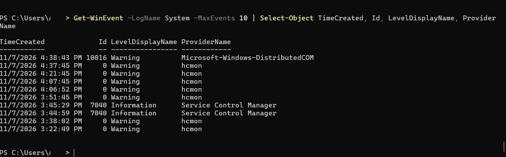

### `Get-EventLog`: classic System log query

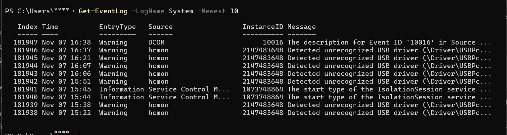

### Full service list

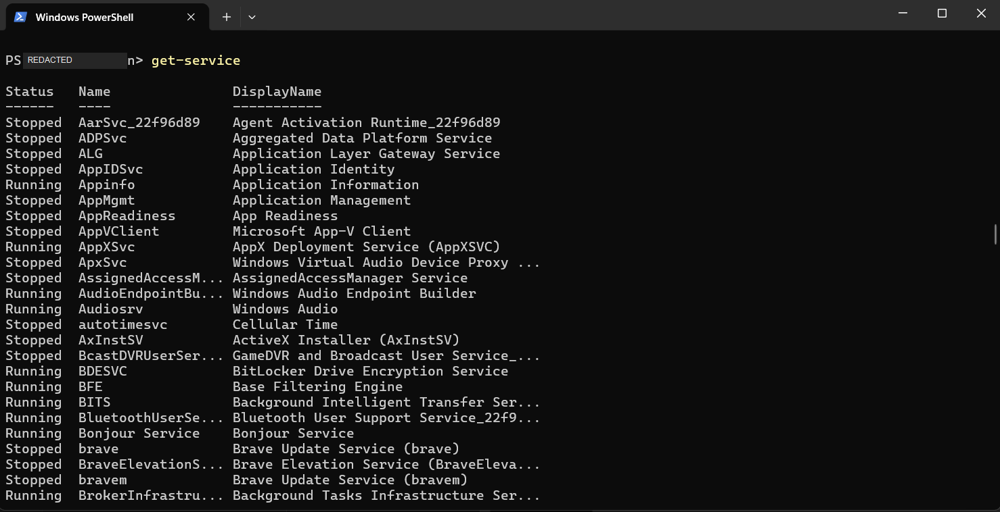

### Network interfaces

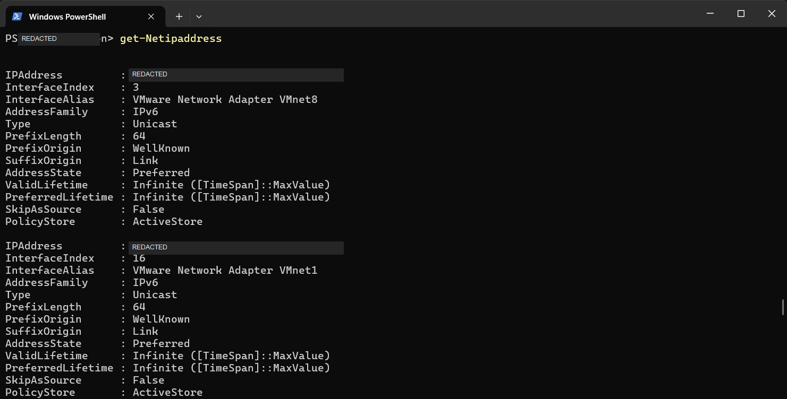

### Computer information

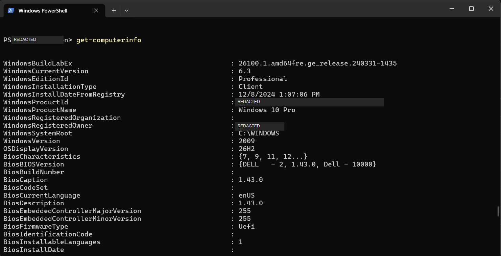
