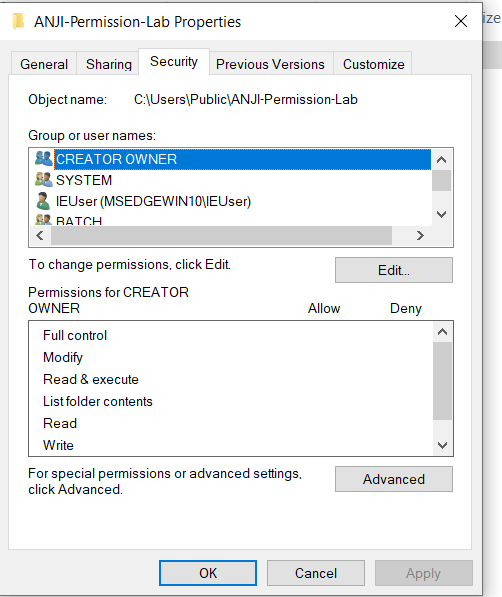
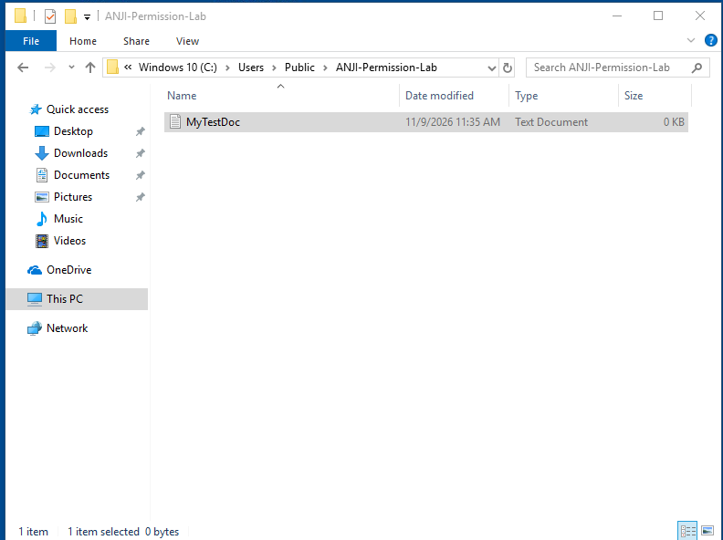
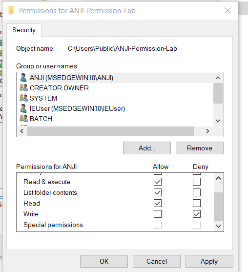
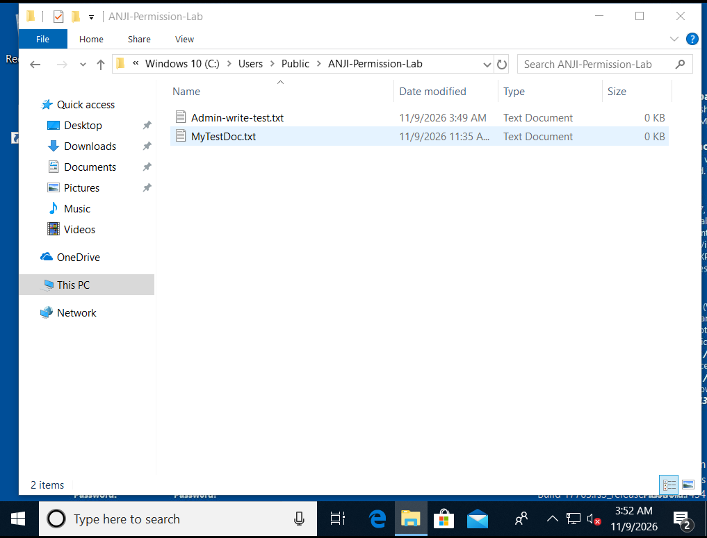
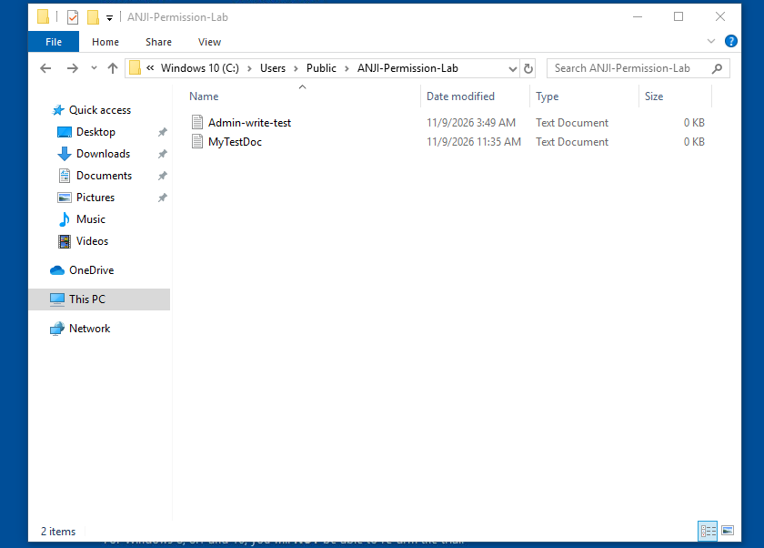
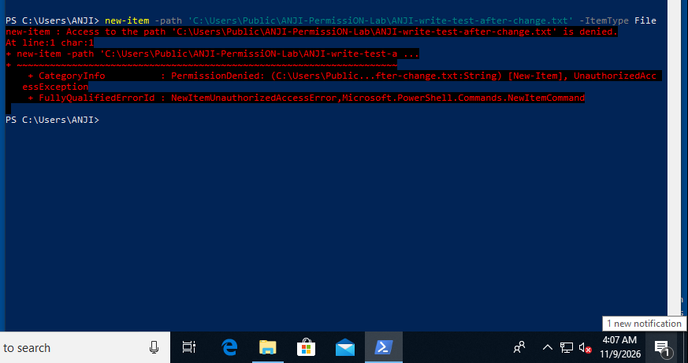

# NTFS Permissions

## Lab folder

```text
C:\Users\Public\ANJI-Permission-Lab
```

The folder was created inside the Windows 10 VM, under Public, specifically for this exercise. The initial Security tab showed inherited Windows permission entries. ANJI could initially create `MyTestDoc` there.

## Permission change

A permission entry was added for the ANJI account:

- **Allow:** Read & execute, List folder contents, Read
- **Deny:** Write

The change was applied only to the lab folder. The VM administrator retained Full control. This was a deliberate exercise to observe how a user-specific Deny affects access in the presence of inherited permissions.

> In routine administration, prefer removing unnecessary broad Allow permissions and granting the minimum needed. Explicit Deny entries can override Allow entries from other groups and should be used carefully.

## Results

- Before the change, ANJI created `MyTestDoc`.
- After the change, ANJI could view the folder and see `MyTestDoc` and the administrator-created `Admin-write-test`.
- The administrator created `Admin-write-test` in the same folder.
- As ANJI, the following command against the exact lab path returned **Access is denied**:

```powershell
New-Item -Path 'C:\Users\Public\ANJI-Permission-Lab\ANJI-write-test-after-change.txt' -ItemType File
```

This verifies that ANJI could list the existing files but could not create a new file using the tested operation. The test does not claim that every possible permission, such as deletion, was separately evaluated.

## Evidence

### Starting permissions



### ANJI could write before the change



### Rule applied to ANJI



### Administrator write access



### ANJI can view the contents after the change



### ANJI write test




