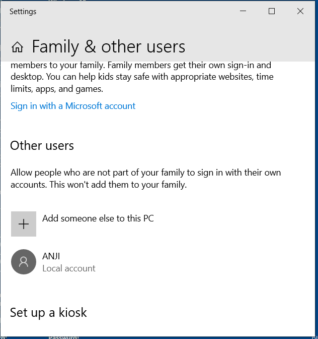
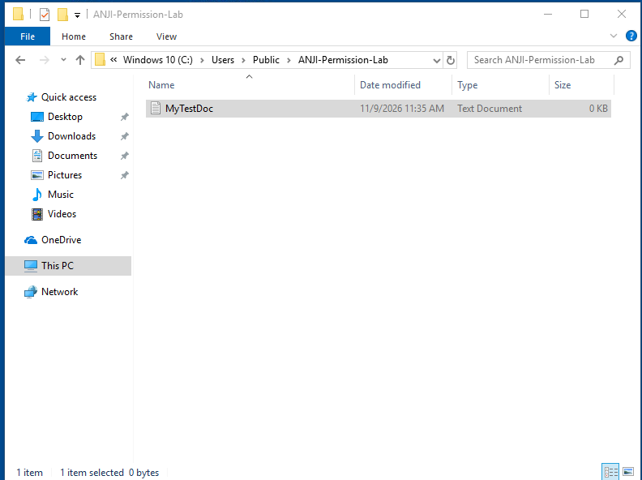
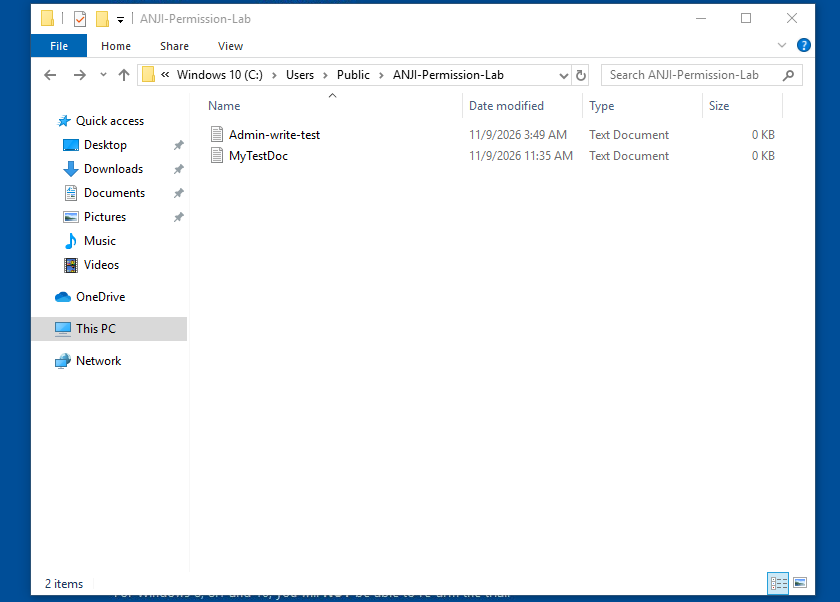

# User Accounts

## Lab environment

The exercises were performed in a Windows 10 virtual machine. The account used to create and configure the lab folder was the VM's administrator account. The test account was **ANJI**, a local **Standard user** account.

The VM account is separate from accounts on the host computer. The practice folder was stored on the VM's own C: drive.

## What the account types mean

- **Administrator:** can make system-wide changes, install software, and manage other accounts and permissions, subject to Windows User Account Control.
- **Standard user:** can use the computer and work with files permitted by their access rights, but cannot freely make system-wide changes.

ANJI was verified as a Standard user in Settings. The `whoami /groups` output also showed `BUILTIN\Users` and did not show `BUILTIN\Administrators` in the displayed logon token.

## Exercise result

ANJI could create `MyTestDoc` in the shared lab folder before the permission change. This demonstrated that a standard account can still create files when the folder permissions allow it.

After the lab permission change, ANJI could see the folder contents, but PowerShell returned **Access is denied** when ANJI attempted to create a new file at the lab path.

## Evidence

- 
- 
- 

