# Module 4 Evidence

These are the original screenshots shared during the exercise. Process IDs and service states are observations from the time they were captured.

## Processes

### Task Manager process list

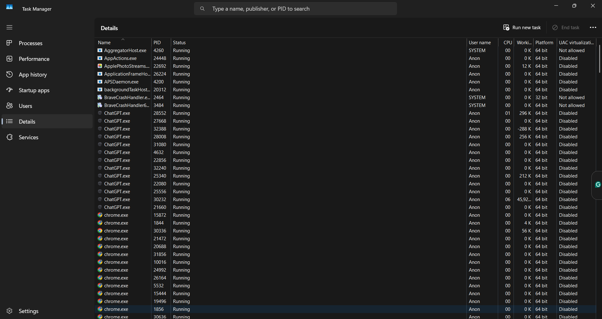

### PowerShell process paths

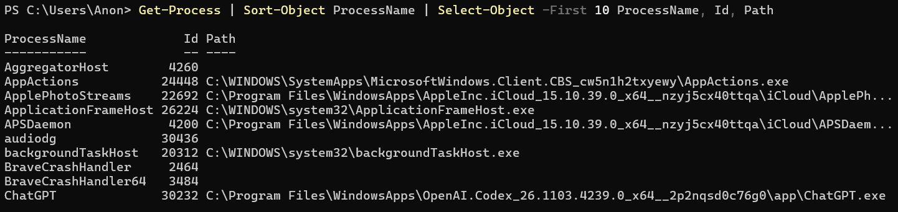

### AppActions.exe location

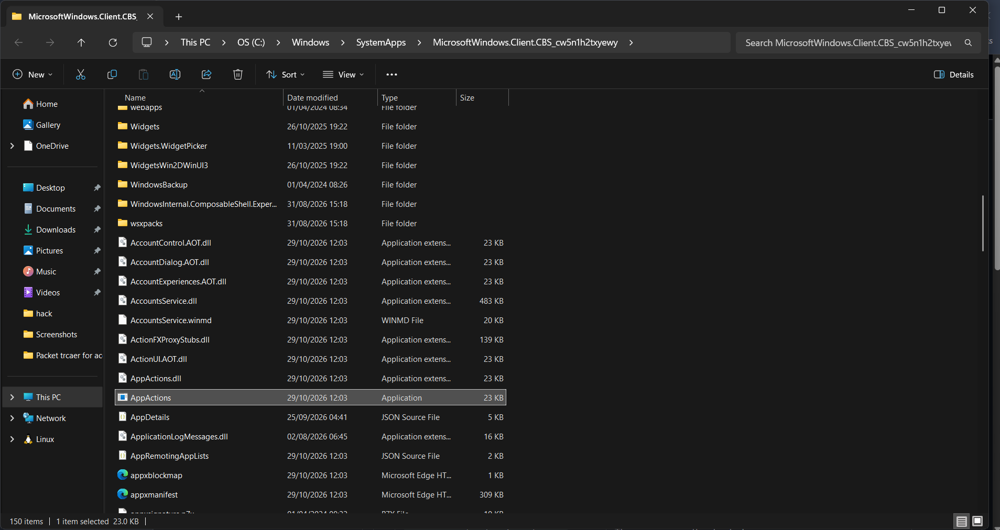

### Apple iCloud Photo Streams location

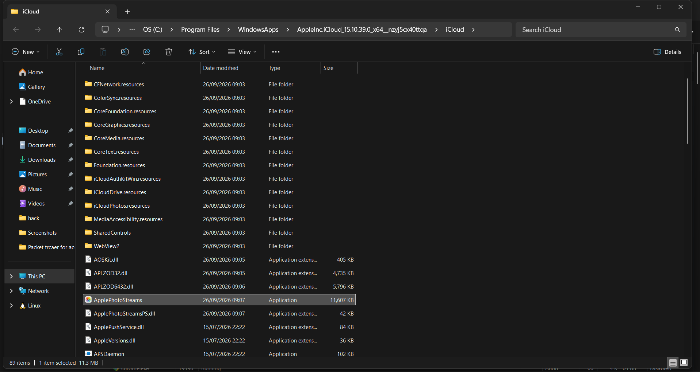

### ApplicationFrameHost.exe location

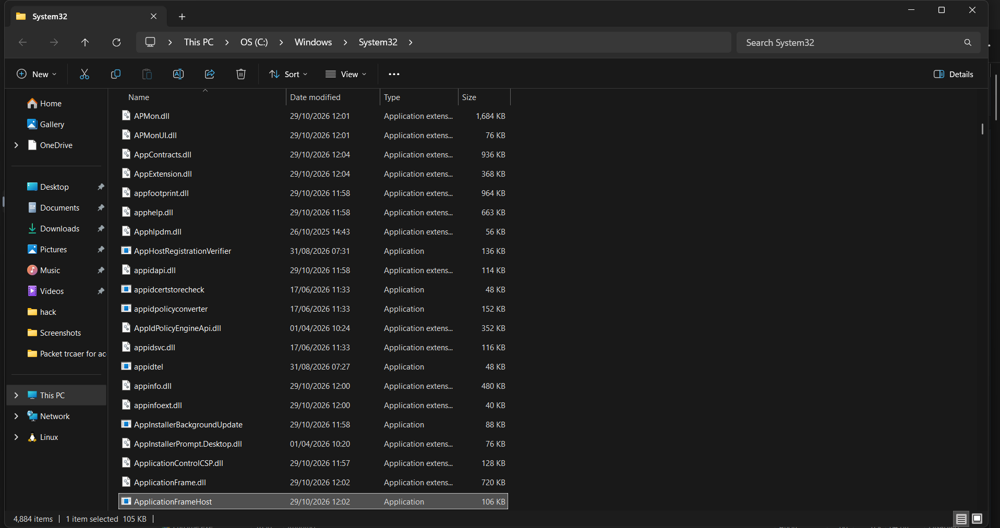

### APSDaemon.exe location

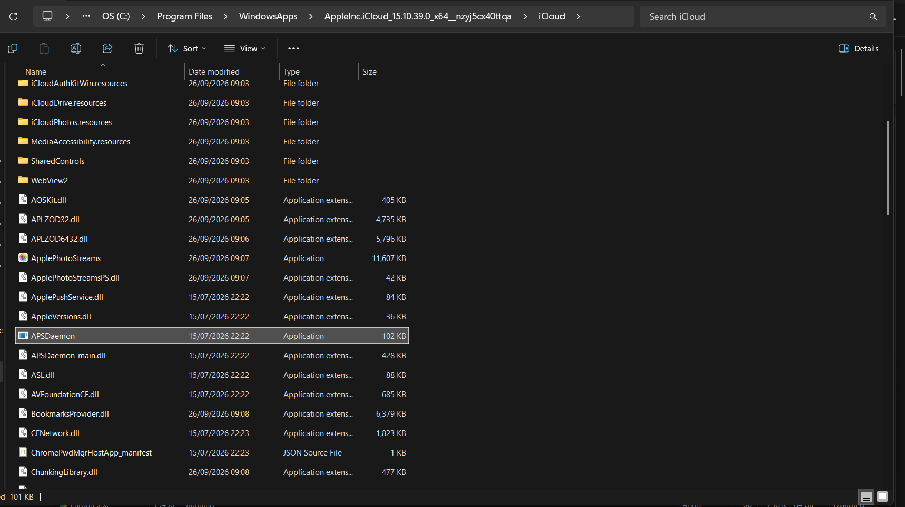

### audiodg.exe location

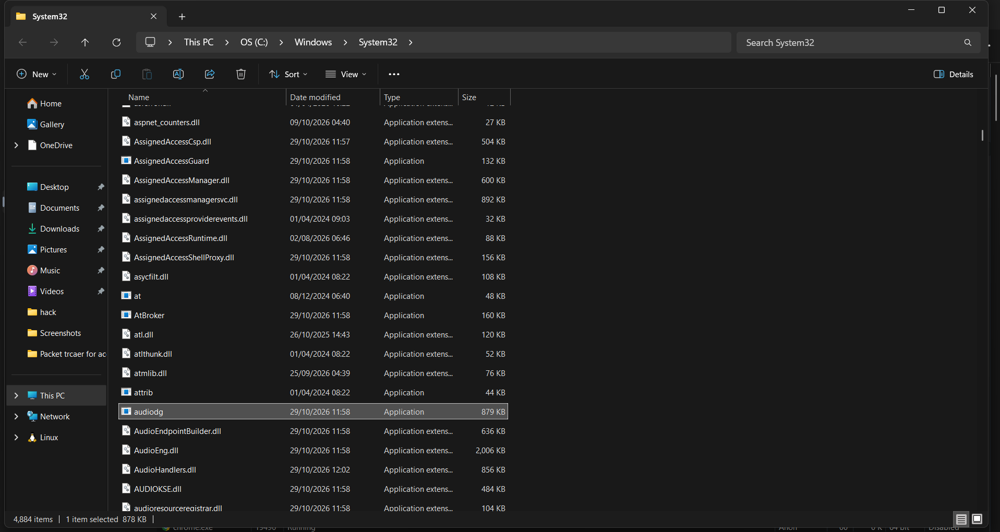

### Parent process check

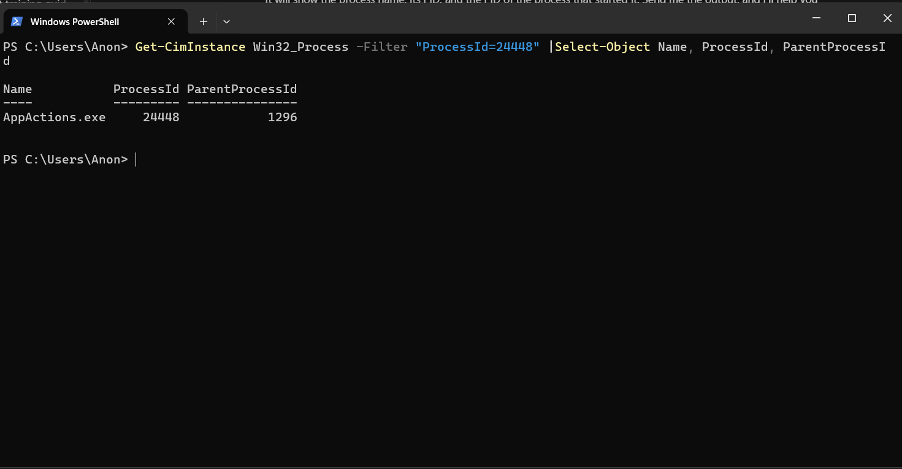

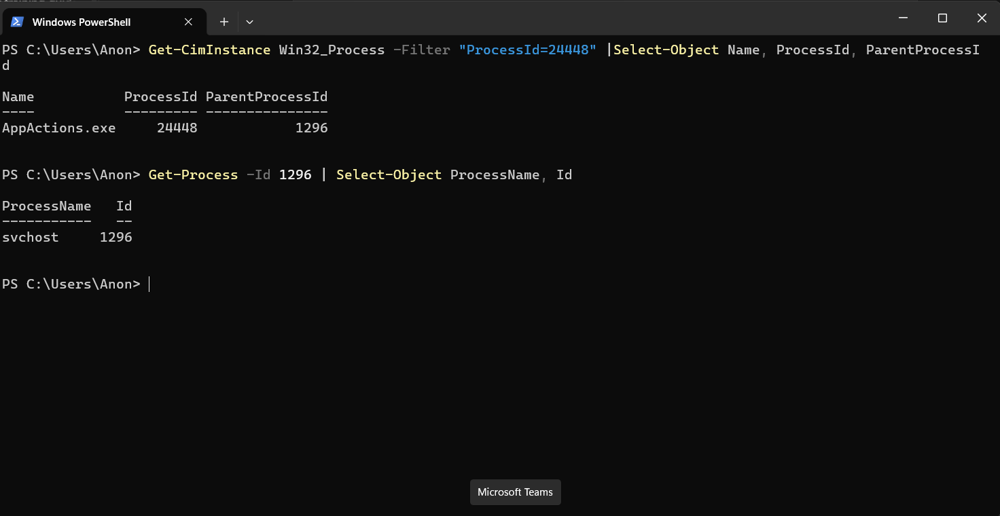

## Services

### Five running services

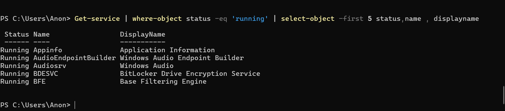

### Five stopped services

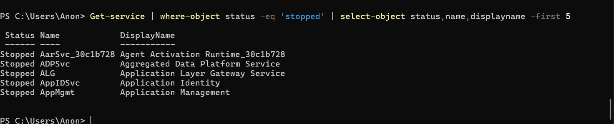

### Application Identity service details

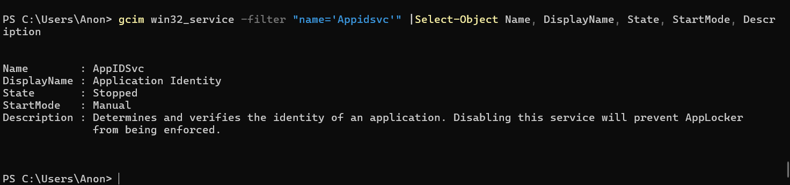
