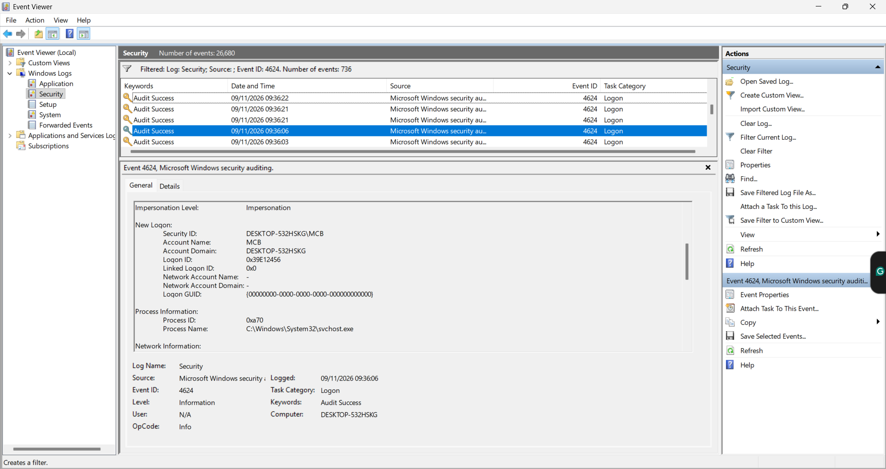

# Successful Login Analysis

## Observation

| Field | Value observed |
|---|---|
| Log | Security |
| Event ID | 4624 |
| Result | Audit Success |
| Date and time | November 9, 2026, 09:36:06 (local time shown in Event Viewer) |
| New Logon account | MCB |
| Logon type | 2 — interactive logon at the computer |
| Process name shown | `C:\Windows\System32\svchost.exe` |

The account involved is shown under **New Logon**. The separate **Subject** fields describe the account that reported/requested the event; they should not be confused with the New Logon account.

## Interpretation

This event records a successful interactive logon for MCB on the host PC. I was attempting to sign in to MCB around this time. The event is consistent with that activity, although the log does not identify who was physically using the keyboard. The separate account I created for practice in VMware is not the account shown in these screenshots.

A separate 4624 event I viewed was for **SYSTEM** with logon type 5, which means a service logon. That service event is not the same as the interactive MCB logon.

## Evidence

[Evidence index](evidence/README.md)

