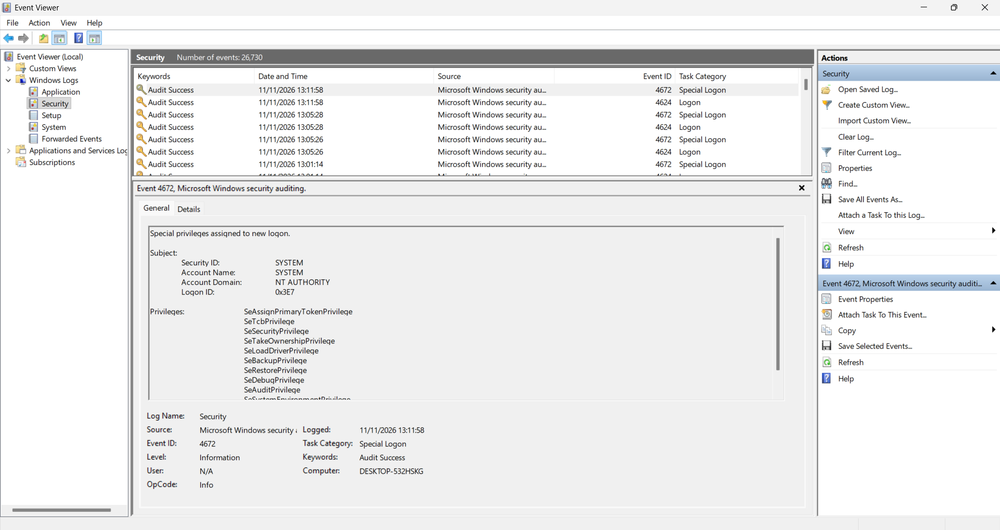
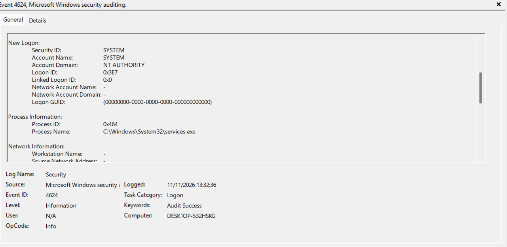
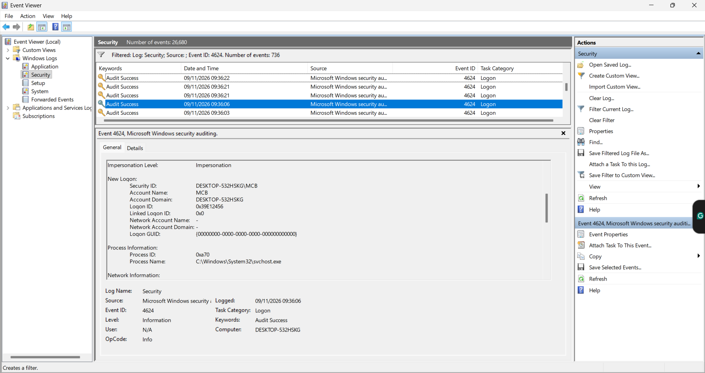

# Module 5 Event Viewer Screenshots

These screenshots come from the Windows Security log. The MCB examples are from the host PC account, not the separate VMware practice account. The failed and successful MCB events match the sign-in attempt I reported. The SYSTEM event is a background service logon and is separate from MCB.

## Security log overview

Event 4672 (special privileges assigned to a new logon) is visible in the initial log view. It is background context; the analysis in this module focuses on logon events 4624 and 4625.

## Successful service logon (Event 4624, Logon Type 5)

This event is for SYSTEM and a service logon, not an interactive sign-in by MCB.

## Failed MCB interactive logon (Event 4625)

The selected event shows MCB, Logon Type 2, and “Unknown user name or bad password.” The filtered list contains three failures; only the selected entry is interpreted in the analysis.

## Successful MCB interactive logon (Event 4624)

The selected event shows MCB under **New Logon**, Logon Type 2. The event is consistent with my reported attempt to sign in to MCB on the host PC. It does not represent the separate user account created in VMware.

