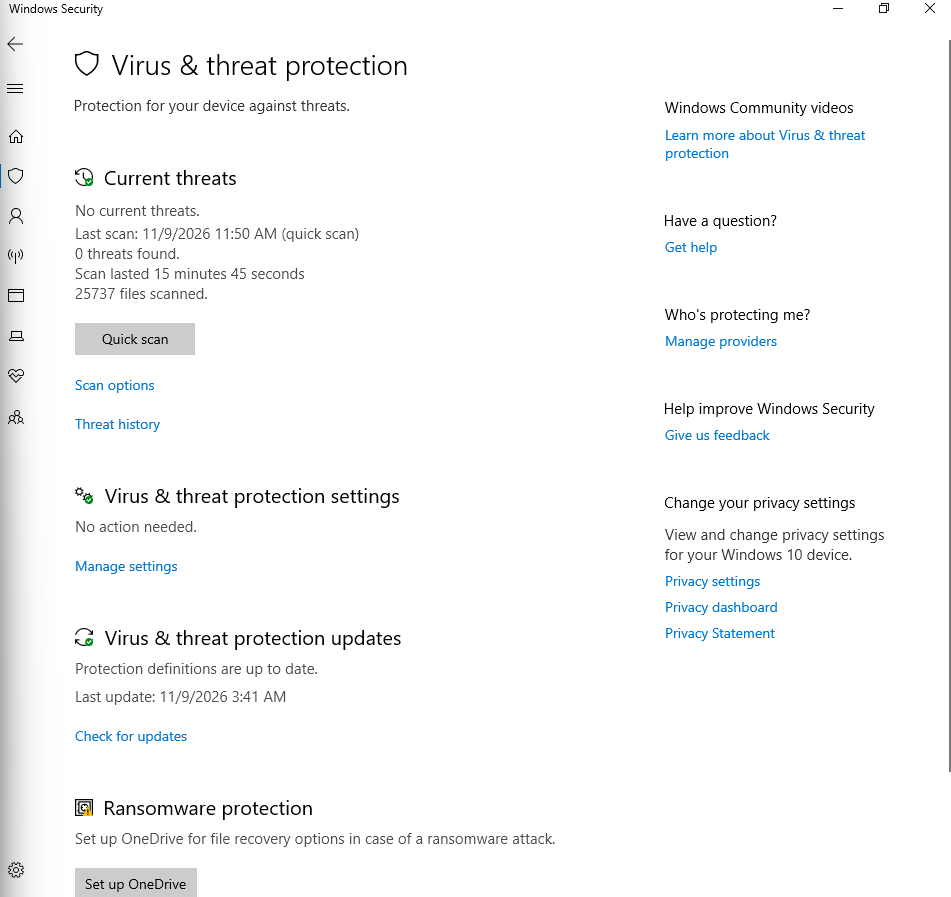
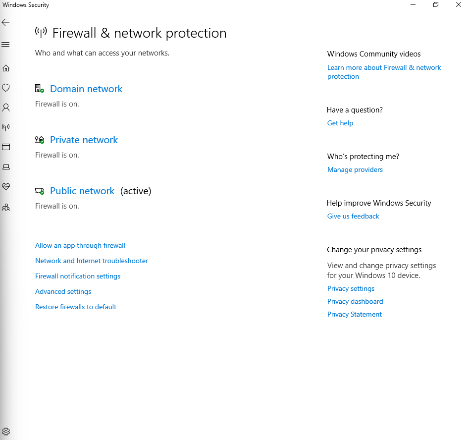
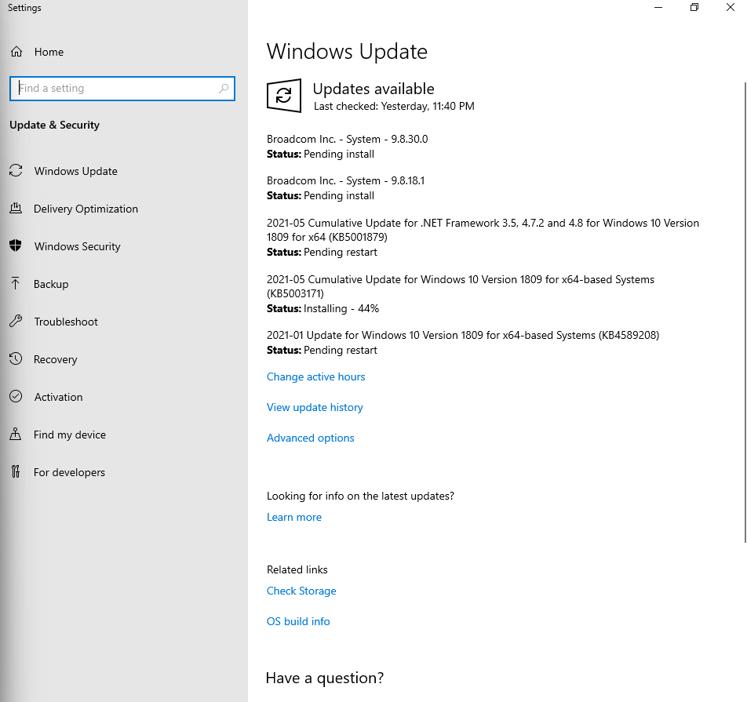
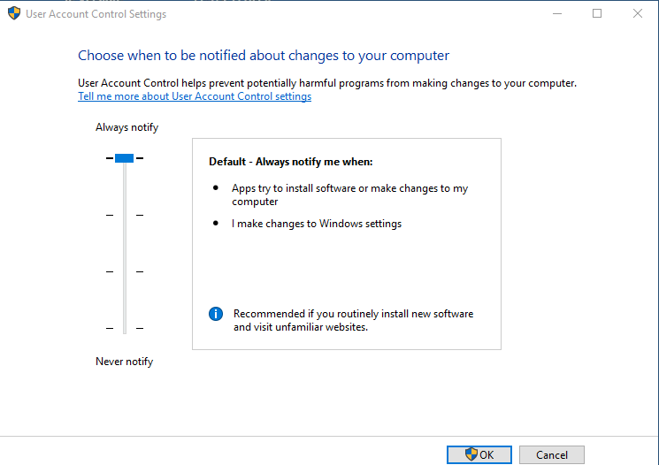
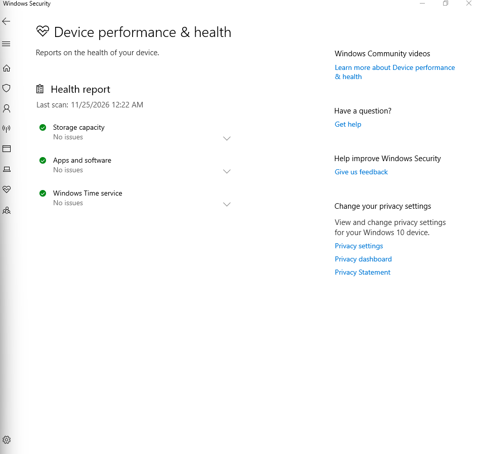

# Module 6 Screenshots

These screenshots were reviewed before sharing. The UAC image was cropped to remove the VM name visible behind its window. The other captures show Windows security settings and status, without account names or passwords.

## Security overview

## Virus and threat protection

The service briefly showed a stopped message and I restarted it. This is the later page, after the restart.

## Firewall profiles

## App and browser control

Warn was selected for the SmartScreen checks shown.

## Account protection

The VM was not signed in to Microsoft; Windows Hello and Dynamic lock were not set up.

## Device security

## Windows Update

The screenshot records updates pending install/restart and one cumulative update installing at 44%. Completion was not verified.

## User Account Control

This cropped image removes the VM name visible behind the UAC window.

## Device health report

